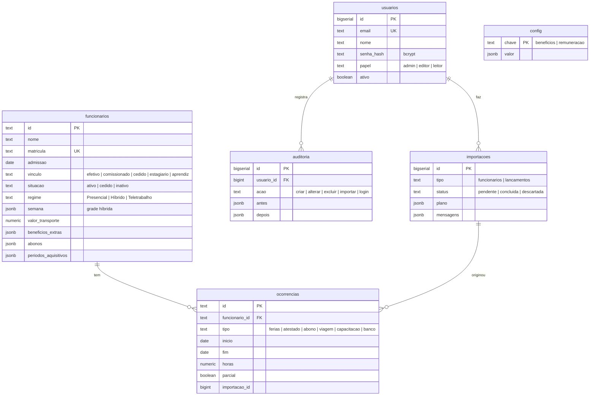

# Esquema do banco de dados

PostgreSQL 16. O DDL completo está em [`db/schema.sql`](../db/schema.sql). Ele é idempotente: a aplicação roda o
arquivo em toda subida e o Postgres também o executa na primeira criação do volume.

## Tabelas

### `funcionarios`
Uma linha por pessoa: efetivo, comissionado, cedido, estagiário ou aprendiz.

| Coluna | Tipo | Regra | Uso |
|---|---|---|---|
| `id` | text PK | | identificador estável usado pelo painel (os importados da versão anterior mantêm `p-004`, `c-012`…) |
| `nome` | text | obrigatório | |
| `matricula` | text | única quando preenchida | chave das importações |
| `admissao` | date | | tempo de casa, nível salarial automático, períodos aquisitivos |
| `cargo`, `setor` | text | | cargo base do concurso; lotação |
| `vinculo` | text | `efetivo`, `comissionado`, `cedido`, `estagiario`, `aprendiz` | |
| `situacao` | text | `ativo`, `cedido`, `inativo` | cedido sai da folha |
| `regime` | text | `Presencial`, `Híbrido`, `Teletrabalho` | |
| `carga` | smallint | 1–60 | horas/semana |
| `intervalo` | smallint | 0–180 | minutos de almoço |
| `entrada`, `saida`, `entrada_ho`, `saida_ho` | time | | horários presenciais e de teletrabalho |
| `semana` | jsonb | | grade híbrida por dia (`P` presencial, `H` home office, `M` misto 6h+2h) com horários |
| `funcao`, `funcao_tipo`, `nivel`, `portaria_funcao`, `ingresso` | text | `funcao_tipo`: `comissao`/`fg`; `nivel`: I–VI | nomeação |
| `orgao_origem`, `cedido_para` | text | | cessões |
| `jornada_diaria` | smallint | 4 ou 6 | estágio/aprendizagem |
| `instituicao`, `contrato_inicio`, `contrato_fim`, `providencia` | text/date | término ≥ início | contrato de estágio/aprendizagem |
| `usa_transporte`, `valor_transporte` | boolean, numeric(12,2) | valor ≥ 0 | auxílio-transporte (mensal ou diário, conforme as regras) |
| `beneficios_extras` | jsonb | | `[{tipo, descricao, valor, recorrencia: mensal\|meses, meses[0-11], inicio "AAAA-MM", fim}]` (creche, natal, funeral, outro) |
| `abonos` | jsonb | | saldos por referência: `{ref2024: {usados, restantes, semData[], semDireito, falta, cedido}, ref2025, folgas2026}` |
| `periodos_aquisitivos` | jsonb | | controle de férias por período: `[{inicio, fim, limite, direito, programadoPlanilha, pendencia, analise, obs}]` |
| `carreira`, `nivel_salarial`, `fg_tipo`, `bolsa_tipo` | text/smallint | ver CHECKs | enquadramento na Estrutura Remuneratória (vazio = automático) |
| `extra` | jsonb | | campos auxiliares sem coluna própria (origem da importação, linha da planilha); o painel os recebe de volta |
| `criado_em`, `atualizado_em` | timestamptz | | |

### `ocorrencias`
Férias, atestados, abonos, viagens, capacitações e banco de horas. `ON DELETE CASCADE`: excluir o funcionário apaga os
lançamentos dele.

| Coluna | Tipo | Regra | Uso |
|---|---|---|---|
| `id` | text PK | | |
| `funcionario_id` | text FK | obrigatório | |
| `tipo` | text | `ferias`, `atestado`, `abono`, `viagem`, `capacitacao`, `banco` | |
| `inicio`, `fim` | date | `fim ≥ inicio` | dias corridos, inclusive |
| `horas` | numeric(6,2) | | banco de horas (+/−); horas parciais de abono/capacitação/atestado meio período |
| `parcial` | boolean | | atestado de comparecimento ou meio período: conta o atestado, não o dia |
| `destino`, `diarias` | text, numeric | | viagens e capacitações |
| `parcela`, `aquisitivo`, `aquisitivo_fim`, `limite`, `abono_pecuniario`, `aviso_ferias`, `status_planilha` | | `abono_pecuniario` 0–10 | férias |
| `referencia_abono`, `status_abono` | text | `agendado`/`gozado` | abonos ligados ao saldo anual |
| `obs` | text | | **nunca** CID/diagnóstico |
| `origem`, `importacao_id` | text, bigint | | rastreio: tela, importação nº X |

Índices: `(funcionario_id, tipo, inicio)` e `(inicio, fim)`.

### `config`
| `chave` | Conteúdo de `valor` |
|---|---|
| `beneficios` | `{aa: 2100, pctTemp: 50, limite: 15, modo: "todos"\|"excedente", atModo: "mensal"\|"diario", atFerias: false, feriados: ["2026-01-01", …]}` |
| `remuneracao` | Estrutura Remuneratória 2026–2028: `carreiras` (analista, tecnico, apoio: 30 níveis), `comissao` (I–VI: salário + gratificação 60%), `fg` (chefia, assessor2, assessor1), `estagio` (bolsas), `beneficios` (alimentação, creche, natal, funeral) |

Editores alteram `beneficios`. Só administradores alteram `remuneracao`.

### `usuarios`
Acesso ao sistema. `papel`: `admin` (tudo), `editor` (cadastra, lança, importa, regras), `leitor` (consulta).
Senha em bcrypt (custo 12), com no mínimo 10 caracteres.

### `importacoes`
Cada envio de planilha. `plano` guarda as operações validadas até a confirmação e é limpo depois. `mensagens` guarda os
erros e avisos por linha. Pendentes com mais de 1 dia são descartadas automaticamente.

### `auditoria`
Registra login, criação, alteração, exclusão e importação, com o estado **antes** e **depois** de cada registro (LGPD:
rastreabilidade de quem alterou dado pessoal). Para expurgar registros antigos:
`DELETE FROM auditoria WHERE em < now() - interval '5 years';`

## Mapeamento para o painel
O painel trabalha com documentos JSON em camelCase (`entradaHO`, `valorTransporte`, `func`…). A conversão
coluna ↔ campo está em [`app/mapping.py`](../app/mapping.py). Campos desconhecidos vão para `extra` e voltam intactos,
de modo que o painel nunca perde informação ao salvar.
